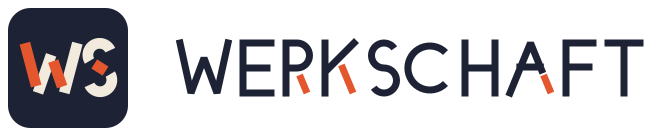

<p align="center">
  <picture>
    <source media="(prefers-color-scheme: dark)" srcset="ai-docs/ref/brand/werkschaft-dark.svg">
    
  </picture>
</p>

# Werkschaft

Werkschaft (`ws`) is an agentic development environment: a workflow, the
plugin packages that carry it into AI coding hosts, and the native runtime
behind them. A lead session talks with you, settles decisions, and captures
work as tickets; worker agents execute those tickets, independent reviewers
check the result, and the lead carries it to merge and release.

> The repository is still published as `kang-sw/devenv`. Install commands
> below use that path until the rename.

## How It Works

```text
Full ceremony:  discuss -> ticket -> run -> review
Delegate:       delegate <bounded task> -> follow-up -> review
Direct:         run <ticket>
Queue:          run (no argument) -> next ready ticket, one worker per cycle
Review:         review [branch|range] -> verdict -> fix | comment | discuss | merge
Release:        ship <project> -> release gate -> execute
```

- **The lead decides, workers execute.** The lead owns the conversation and
  the decisions; `run` hands a ticket to a worker, which implements,
  verifies, gets an independent review, and commits.
- **Tickets are files.** Work lives under `ai-docs/tickets/`, and its status
  is the directory it sits in: `idea/`, `todo/`, `ready/`, `.done/`,
  `.dropped/`.
- **`AGENTS.md` is the project's root context.** Hosts that need their own
  file (such as Claude Code's `CLAUDE.md`) get a shim that points at it.
- **Host-neutral.** The same skills run on Codex, Claude Code, and Pi through
  the `ws` MCP tools.

## Packages

| Path | Package |
|---|---|
| `agents-plugin/` | `ws` plugin: workflow skills, hooks, and MCP wiring |
| `agents-plugin-wsflow/` | `wsflow`: the same product with conservative defaults (optional Claude Code features off) |
| `agents-plugin-pi/` | Pi harness package |
| `agents-plugin-tool/` | Go source of the native `ws-mcp` runtime and tooling |

## Install

### Claude Code

```sh
claude plugin marketplace add kang-sw/devenv
claude plugin install ws@kang-sw-devenv
```

`.claude-plugin/marketplace.json` also lists `wsflow` for manual
installation.

### Codex

Codex installs use the repository marketplace entries under
`.agents/plugins/`, which expose both `ws` and `wsflow`.

### Pi

The `ws` workflow tools are also available inside Pi
(`@earendil-works/pi-coding-agent`) sessions through a bundled extension.
Install it straight from this repo with Pi's own git package manager:

```sh
pi install git:github.com/kang-sw/devenv@<tag>
```

Replace `<tag>` with a published release tag (for example `v0.49.1`). The
`<host>` segment (`github.com`) is required — Pi's git spec is
`git:<host>/<user>/<repo>`, and a host-less `git:kang-sw/devenv` mis-parses
`kang-sw` as the host and fails to resolve.

Pi clones the repo, runs `npm install` against the repo-root
`package.json` (which declares the extension and its runtime dependencies),
and loads the extension. No local build step is required: on first use the
extension's launcher downloads the release's `ws-mcp` binary, verifies its
checksum, and registers the `ws/*` tools automatically.

## Repository Layout

```
agents-plugin/         ws plugin package
agents-plugin-wsflow/  wsflow plugin package (conservative defaults)
agents-plugin-pi/      Pi harness package
agents-plugin-tool/    native ws MCP runtime and tooling source
ai-docs/               tickets, manuals, references, and repo notes
nvim/                  Neovim config
shell/                 tmux, WezTerm, Starship, zsh, helper scripts
scripts/               repository helper scripts
tools/                 local Claude session TUIs
```

`ai-docs/` is this repository's own workflow instance: `tickets/` by status
directory, `manuals/` for procedures, `ref/` for static references,
`ws-notes/` for the tracked note layer, and `WORKFLOW.md` as the plugin-less
maintenance guide.

## Workstation Setup

This repository also carries a personal workstation configuration: Neovim,
tmux, WezTerm, Starship, zsh, shell helpers, and the local `claude-watch` and
`claude-dash` TUIs under `tools/`.

```sh
git clone https://github.com/kang-sw/devenv.git ~/devenv
cd ~/devenv
bash install.sh          # idempotent; safe to re-run
bash install.sh update   # skip packages & sudo, refresh config and symlinks
```

`install.sh` detects macOS, WSL, and Linux. Full mode installs packages and
writes config; `update` mode skips package installation and refreshes
dotfiles, symlinks, and local plugin setup. When Claude Code is available it
also registers a Claude-compatible snapshot of `agents-plugin/`; it does not
install `wsflow` into Claude.

> Neovim 0.10+ is required but not installed by the script.

## License

Licensed under the [Apache License 2.0](LICENSE).
