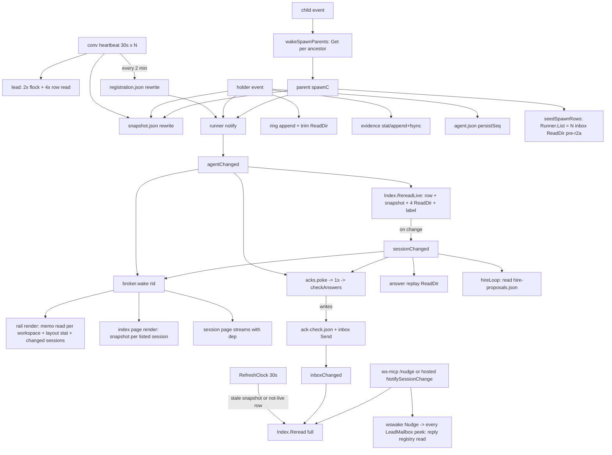

# Daemon file-touch map: what each file does, how it is coupled, and where reduction pays

## Background

On the owner's Windows PC the shared dashboard daemon spends most of its CPU in
file syscalls. AhnLab V3 makes each one 10-100x slower, and its scanner
(`ASDSvc`) uses more than a full core while the daemon churns files. The owner
gated the release on this (clone note `release-gate-daemon-file-io-20261117`).

Owner, 2026-11-17 13:30-13:31, verbatim:

> 애초에 ASDSvc라던지 이런 검사 프로세스의 CPU 점유 자체가 파일 터치할 때 일어나는거라 근본적으론 우리가 파일 터치를 최소화해야 합니다. 백업 목적의 flush만 하기, 필요한 delta만 쓰기, etc etc ... 그리고 대화가 228개나 떠있다는 것도 납득은 안 가고요. 서브에이전트가 하나도 정리가 안 되고 있거나 그런 거 같은데. 제가 손으로 띄운 세션도 200개가 안 될거라

> 아뇨 이건 근데 일단 그냥 고치라고 하지 말고, 티켓부터 잡아서 설계부터 합시다

> 어느 부분이 어떻게 엮여있고 어떻게 줄여야 효과적인지, 이런 부분을 먼저 파악해야 상태 유실이라던지 품질 문제가 발생하지 않습니다.

Translation:
- The scanner's CPU use is caused by file touches, so the root fix is to
  minimize file touches: flush only for backup, write only the needed deltas,
  and so on.
- 228 live conversations make no sense. Subagents seem never to be cleaned up;
  the owner launched fewer than 200 sessions by hand.
- Do not just order fixes. Open a ticket and design first.
- First understand which parts are coupled and how, and which reductions are
  effective, so that the reduction causes no state loss or quality problems.

This ticket is that understanding step. It maps the daemon's file touches
before any write-strategy change is designed. Implementation tickets derive
from its Outcome Ledger.

## Scope

In scope:
- Every file the shared daemon process (`ws-mcp-dashboard-*.exe`) reads,
  writes, stats or lists in steady state and on interactive paths, grouped by
  store.
  - wsagent conversation records: `snapshot.json`, the ring and the record
    file.
  - The registration / lock rows.
  - The wsinbox held, drained, answer-pending, attachment and journal
    directories.
  - The wslive observed evidence (`model-evidence`), the snapshot cache and
    the Index.
  - The whiteboard folders and their flock.
  - Mailbox, tracker and plan-usage history.
  - The localhost secret and endpoint files.
  - Ticket listings and record files read for lead pages.
- For each store:
  - **Writers and readers:** who writes it and who reads it, in-process and
    cross-process, including older same-minor clients, the launcher,
    standalone `ws-mcp` commands, hosted processes and Electron.
  - **Trigger:** what triggers each touch (event, timer, heartbeat, request).
  - **Rate and cost:** measured or estimated rate, and amplified cost.
  - **Restoration role:** what the file restores after a daemon restart or
    crash, and what would be lost if it were written later or less often.
  - **Ordering and atomicity:** the guarantees a reader relies on.
  - **Compatibility:** the AGENTS.md compatibility tier of changing its timing,
    its granularity (delta vs rewrite), or its existence.
- **Coupling:** where one store's write triggers rereads of others, such as:
  - runner write → `agentChanged` → `Index.Reread` → record, board and ticket
    rereads;
  - snapshot flush → fence → registration reads;
  - `seedSpawnRows` → `Runner.List` → every inbox.

  Include the wake fan-out that turns one write into N reads.
- **Conversation lifecycle:** why 228 `conv.loop` goroutines are live (owner:
  fewer than 200 sessions ever launched by hand). Establish:
  - when conversations are created, including restore at daemon start;
  - when they are dropped;
  - whether ended, stopped or idle-timed-out conversations keep a loop,
    heartbeat and snapshot writes.

Out of scope:
- Implementing write-strategy changes. Each one gets its own actionable
  ticket, derived from the Outcome Ledger.
- Page payload and client rendering (sibling research
  `261117-research-ws-dashboard-data-only-client-assembly`).

Already in flight (bounded fixes that keep on-disk shape and write timing; this
research takes their results as the baseline):
- `impl/develop/daemon-io-r2a`: M8 answer-replay lock, M2 evidence-cache sweep
  locking, M1 in-memory held counts, M5, M4, syscall counter seam.
- `impl/develop/hosted-send-path`: F2, `PageInput` off the message POST path.
- `impl/develop/composer-instant-bubble`: F1, optimistic client bubble.
- r2b, merged at af93c65b3: incremental rail and live-store-only rereads.

## Questions

1. **The touch inventory.** Which stores account for the touches, in
   touches/s on the owner's PC? Ranked, with the code path for each.
2. **Restoration contract per store.** Which data must be on disk:
   - before acknowledging the user (for example, an accepted message);
   - within a bounded window (for example, a live snapshot);
   - only at clean stop?

   Which files are pure caches that could be dropped or rebuilt?
3. **Coupling graph.** Which writes cause rereads elsewhere, and which reads
   exist only because the daemon rereads its own writes?
4. **Reduction options and their failure modes.** For each high-rate store,
   evaluate:
   - RAM-only plus periodic or clean-stop flush;
   - append-only delta instead of whole-file rewrite;
   - dropping fsync where atomic rename suffices;
   - coalescing;
   - dropping heartbeat-only writes;
   - in-memory ownership fences.

   For each option, state:
   - the state-loss window on crash;
   - the effect on restart recovery, staleness badges and cross-process
     readers;
   - its compatibility tier.
5. **Conversation leak.** What is the lifecycle gap behind 228 loops? What is
   the safe cleanup rule, and what restore behaviour does it imply?
6. **Ordering.** Given the coupling, which changes must land together, and
   which first, to reduce touches without state loss?

## Q1: Touch inventory

Baseline: develop `f7f44934b`, the build that was running at the 13:26 capture
(`ws-mcp-dashboard-bd6896f245444272.exe`, built 12:34). **Every file:line in
this ticket is at `f7f44934b`.**

r2a was merged into develop at `bf7a5c5a0` while this research ran. Commit
`f44bddbaa` through `b7920aa14` plus follow-ups such as `b1aff20b1` and
`58f189747`. It was not deployed in the capture, so its expected effect is
listed separately.

### Measurement sources

**CPU profile (`D:/Temp/daemon-live-1314/cpu.pb.gz`, 20 s, 9.89 s of samples).**
I classified `go tool pprof -traces` stacks by the first `internal/` frame
above `syscall.SyscallN`. 7.17 s (72.5%) of the samples are in file syscalls.
By syscall:

| syscall | time |
|---|---|
| CreateFile | 3.02 s |
| CloseHandle | 1.20 s |
| GetFileAttributesEx (stat) | 1.19 s |
| GetFileInformationByHandleEx (readdir) | 0.71 s |
| MoveFileEx | 0.51 s |
| GetFileInformationByHandle | 0.16 s |
| FlushFileBuffers | 0.11 s |
| WriteFile | 0.04 s |

Writing is cheap. Opening, closing, stat and listing dominate. These are the
operations the AV filter driver intercepts.

**Process I/O counters (`process.txt`, 13:17).**

| metric | value |
|---|---|
| "other" operations | 4,823/s (WMI 3,600/s) |
| reads | 360/s |
| writes | 15–28/s |
| ASDSvc CPU | 105% |

**Stream counters (`streams.json`, 13:26).** Daemon uptime was about 51 min
(the oldest goroutines in `goroutine.txt` are 51 minutes old), about 3,060 s.

| counter | total | rate |
|---|---|---|
| `wake_agent` (runner `notify`) | 17,421 | 5.7/s |
| `wake_session` | 11,112 | 3.6/s |
| `wake_live` | 3,321 | 1.1/s |
| lead-row `ReadSession` (changed + unchanged) | 4,969 | 1.6/s |
| snapshot FileCache misses | 16,162 | 5.3/s |
| sends | 4,344 | 1.4/s |
| rail renders | 1,499 | 0.5/s |
| session renders | 1,670 | 0.55/s |

**Disk census (read-only, 14:00).**
- `sessions/` holds 512 session directories and 521 registration rows.
- 228 conversations are open. Their stores hold:
  - 8,110 ring files, with a maximum of 2,000 in one session (the
    `RingHistoryCap`);
  - 4,777 model-evidence files, with a maximum of 2,157 in one session;
  - 0 held inbox entries;
  - 626 drained entries.

### Ranked touch sources (share of the 20 s CPU window, pre-r2a)

| # | store / path | code path | share | rate estimate | after r2a |
|---|---|---|---|---|---|
| 1 | `sessions/*/inbox/` listing and lead permission files, read for **every** conversation | `liveWriter.flushSnapshot` → `beforeSnapshot` = `seedSpawnRows` (`spawn_live.go:115-163`) → `Runner.List` → `conv.state` → `wsinbox.Held` (`runner_conv.go:436`). Also `Runner.Get` from `SpawnLead` and `wakeSpawnParents` (`spawn_live.go:168-191`) | 22.9% | 228 directory listings per `List` call. At most one `List` per second per parent with a child event; also once per conversation at startup (`runner.go:292-299`) | **Removed** by `0ed3b929b` (held counts and spawn projection in memory; its counter test asserts zero I/O for `List` among 200 conversations) |
| 2 | `model-evidence/` full sweep (stat every record, plus `os.SameFile` opens) | rail/page `SnapshotCache.Snapshot` → `ObservedCache.Load` (`wslive/observed_cache.go:109-237`, resweep 15 s at `:16`) | 9.9% | O(records) per resweep per session read. The 2,157-record session costs about 4,300 operations per sweep | Resweep moves to 5 min, with metadata compare and no opens (`7e7d7be49`), built outside the slot lock (`b7920aa14`) |
| 3 | Index rereads: registration, `snapshot.json`, four directory listings, `label.json`; for leads also record parts and the board flock | `Index.drain` → `readLaneLocked` → `agentSessions.ReadSession` → `ReadLiveStoresClock` (`agent_sessions.go:282-330`, listings `:297-309`) | 9.7% | ≤1 read/s per session (`index.go:462`). Agent rows about 8 operations, lead rows about 25–35, plus listings that grow with directory size (ring ≤2,000, evidence ≤2,157 names) | Unchanged. r2b already restricts `agentChanged` to live stores |
| 4 | Heartbeat `snapshot.json` rewrite | `case <-beat.C` (`runner_conv.go:389-400`) → `heartbeatSnapshot` (`record.go:488-489`), which always writes (`:502` skips only for non-heartbeat) → `writeFileAtomic` (`record.go:308-337`): MkdirAll, CreateTemp, Chmod, Write, Close, MoveFileEx | 7.4% (+0.9% lead fence) | 228 / 30 s = **7.6 new-file create+rename/s**, about 46 syscalls/s. Hosted leads add two registration flocks and four row reads per flush (`runner_summary.go:13-30`, called from `publishSnapshot` (`record.go:526-539`) and `withOwner` (`runner_summary.go:47-63`)) | Unchanged; becomes the top writer |
| 5 | Session-page stream stamp and render | `sessionPageSource` / `sessionStamp` → `StampWatched` → `rawStatStamp`; `entryFiles.readRing`/`readHeld`/`readDrained` (`entry_files.go:39-135`) | 5.2% | Per open page: each wake, plus every 15 s tick (`sse.go:51`) gated by a 2 s stamp window (`stream_cache.go:143`) | Unchanged |
| 6 | Rail render: snapshot, ring names, memo files, layout stat | `railView` (`rail.go:36-51`). `readMemoDoc` is an uncached read per workspace on every render (`rail.go:43-49`, `memos.go:28-52`) | 4.3% | ≤1/s, and the rail hears every broker wake (nil deps, `rail.go:219`) | r2b made the per-session inputs incremental; memo reads remain |
| 7 | Change-driven `snapshot.json` rewrite | `liveWriter.write` → `writeSnapshot` on a changed projection (`record.go:445-461`, coalescing at `:502`) | 3.7% (+2.0% fence and evidence under `seedSpawnRows`) | One per state-changing event | Unchanged |
| 8 | `agent.json` rewrite | `lineEnd` → `persistSeq` → `update` → `writeRecord` (`runner_process.go:592-610`, `runner_conv.go:504-515`) | 2.1% | One per holder line that wrote a ring entry, plus one per heartbeat when `seqDirty` | Unchanged |
| 9 | `registration.json` write, lock and check in the conversation loop | `writeRegistration` every 2 min (`runner_conv.go:396-397`, `:527-567`); lead `checkRow` read on the other beats (`:612-616`) | 1.6% | 228 / 120 s = 1.9 writes/s. Each write calls `notify` (`:566`) → `agentChanged` → `RereadLive` (row #3) | Unchanged |
| 10 | `model-evidence/` append: a stat per record even when it exists, then fsync and a hard link | `AppendObserved` (`wslive/observed.go:255-307`, stat at `:274`, `Sync` at `:291`) | 1.1% | Per observed record per apply, including every `seedSpawnRows` replay | Unchanged |
| 11 | Answer check: `ack-check.json`, ring and inbox listings, uncached `snapshot.json` | `ackChecker.poke` → `checkAnswers` after a fixed 1 s delay (`ack_check.go:64`, `:219-301`) | 0.9% | Per `agentChanged`/`sessionChanged` burst that passes the in-memory gate | Unchanged |
| 12 | Ring append plus a trim listing on **every** append | `AppendRing` → `trimRing` → `ringEntryNames` (`wslive/ring.go:175-190`, `:248-256`) | ~0 in this window | One `ReadDir` of up to 2,000 names per append | Unchanged |

**Steady-state floor with no user activity after r2a.** This is a code-derived
estimate; the r2a counters must confirm it. The heartbeat alone gives:
- 7.6 snapshot writes/s;
- 1.9 row writes/s;
- 1.9 `RereadLive`/s, each about 30 operations including two large listings;
- about 0.5 lead `checkRow` reads/s;
- a 229-row full `Index.Refresh` every 5 min (`index.go:17`, `daemon.go:643`).

That is about 150–200 syscalls/s, all multiplied by the number of open
conversations (Q5).

### Smaller stores (from the source map)

- **Whiteboard** (`<root>/ai-docs/whiteboards/<rid>/`):
  - Every read takes the `.lock` flock (`wswhiteboard/folders.go:242-253`).
  - Commits fsync every file (`folders.go:1072-1124`).
  - It is read on each lead full reread (`mcp/dashboard_sessions.go:1041-1074`).
  - Writers: MCP `whiteboard.update` (in the daemon when hosted), answer replay
    and board nudges.
- **Mailbox** (`mailbox.json` per scope, `mailbox-replyids.json`):
  - Writes take a flock, then do load → fn → temp+replace (`wsmailbox/store.go:142-210`).
  - Waits reread the reply registry uncached on each peek
    (`wsmailbox/wait.go:375-412`). Each in-daemon `LeadMailbox` watch peeks on
    every `wswake` nudge, at most 1/s.
- **Tracker:** `StartWatch` stats the journals and refs every 10 s
  (`wstrackerhost/watch.go:19,36-72`). Poll rewrites `host-sync.json` every
  3 min (`wstrackerhost/host.go:1040-1059`).
- **Plan usage:** `pushClaude` runs on every hosted `Publish`, including
  heartbeats (`live_hosted.go:160`). It writes only on change, but re-reads
  `plan-usage-history.json` before each write (`plan_usage_history.go:127-184`).
- **Secret and endpoint files:**
  - `localhost-secret` is re-read uncached on every cookie-authenticated
    request (`localhost_auth.go:58-80`).
  - `endpoint.json` is written once at start (`daemon.go:507`).
  - `endpoint.json` is read cross-process by the launcher
    (`ws-mcp-launcher.py:1030`), ws-mcp (`ensure.go`, `proxy.go`) and Electron
    (`desktop-electron/endpoint.js`).
  - The rate is the HTTP request rate; it was not visible in the profile.
- **Tickets for lead pages:** each lead full reread does `ReadDir` of
  `ai-docs/tickets/{ready,todo}` (`mcp/dashboard_sessions.go:1006-1034`). Ticket
  bodies are read only when that fingerprint moved
  (`mcp/whiteboard_panels.go:37-56`).
- MCP tool handlers, the Pi subagent system, claude-mod and the launcher were
  mapped by a parallel researcher (B). Its findings are in the Outcome Ledger,
  marked "Researcher B".

### Cross-process readers per store (confirms the existing finding)

| store | readers outside the daemon process |
|---|---|
| `snapshot.json` | None for current builds. Readers are the daemon's `SnapshotCache`, runner seeding (`record.go:370`) and closed-row presentation (`runner.go:1315`). `mcp/live_snapshot.go:224` reads only its own terminal session's file. An older daemon after a downgrade reads content at `startConv`. |
| ring | None for current builds. Ring writers outside the runner: `mcp/live_snapshot.go:867-880` (terminal ws-mcp, own session) and `mcp/lead_mail.go:185` (in the daemon). |
| inbox | A standalone `ws-mcp mailbox wait --board-*` polls names every 500 ms (`cmd/ws-mcp/mailbox.go:148-157`). `dashboard.inbox_drain` runs in a standalone `ws-mcp serve` only when that server is not hosted. |
| `registration.json` | Terminal ws-mcp (`dashboardTouch`, `dashboardReconnect`, `PruneRegistrations`, `git_search`); `holder_exit` (`cmd/ws-mcp/holder_exit.go:24-68`); `hosted_login` (`mcp/hosted_login.go:136-164`). With proxy hosting these mostly run in the daemon, but a standalone CLI still reads cross-process. |
| `model-evidence/` | None. |
| whiteboard, mailbox | Every ws-mcp, standalone or hosted. These are authoritative shared stores. |

## Q2: Restoration contract per store

The two failure classes differ:
- **Daemon process crash.** Every completed `write()` survives in the OS cache.
  Only state still in RAM is lost.
- **OS crash or power loss.** Data not fsynced may be lost. Today only these
  are fsynced:
  - model evidence (`observed.go:291`);
  - whiteboard commits (`folders.go:1072-1124`);
  - the answer journal (`inbox.go:693,720-728`);
  - `MoveFileEx(WRITE_THROUGH)` in `wsstate.AtomicReplaceFile`
    (`wsstate/replace_file_windows.go:21-33`), which flushes metadata only.

  Snapshot, ring, record, inbox and registration writes are not fsynced
  (`record.go:308-337`, `ring.go:221-243`, `inbox.go:682-702`).

| store | restores after restart | must be on disk | crash loss if written later |
|---|---|---|---|
| inbox held entry (`inbox/<stamp>-<hex>.json`) | Accepted user message, steer order | **Before acknowledging the user** (HTTP 200) | The user's message. Keep synchronous. One create per message is low rate. |
| answer-pending journal | Board answer not yet recorded | Before acknowledgement; already fsynced | A board answer |
| `agent.json` (Record) | Identity, parent, backend session, `HolderID`/`HolderSeq`, sends/drained/turn marks, steered, claimed mail, pending reports, `LastTurn`, `TurnOpen`, `ClosedAt` (`runner.go:425-525`) | **Ordered with what it describes.** `HolderSeq` must never get ahead of flushed ring/snapshot state, or a replay skips events (`runner_process.go:588-610`). Claimed mail must be recorded before the next turn: `Mail.Drain` removes it from `mailbox.json` first (`runner_conv.go:236-246`). | Claimed mail (an existing small window); replay duplicates if the seq lags (harmless); replay gaps if the seq leads (state loss) |
| ring (`ring/<stamp>-<hex>.json`) | Conversation history shown on the page, `pi.transcript`, answer check | Within a bounded window, if `HolderSeq` is held back with it. A live holder keeps a 4 MiB record ring and replays from `HolderSeq+1` (`wsholder/holder.py:36-76`). | Events since the last flush are re-derivable while the holder lives. They are lost if the holder died too (reboot); the harness's own session file still holds the transcript. |
| `snapshot.json` | Finished subagents (`SeedFinished`, "nothing else remembers them", `record.go:357-384`), last turn, usage/limits, commands. It is also the staleness clock and the **in-process transport for non-hosted conversations** (Q3). | Bounded window for content. **No need for heartbeat-only rewrites** if staleness moves to RAM (Q4). | Finished-subagent rows and usage changes since the last flush |
| `model-evidence/` | Observed-model audit history | Write-once; fsynced today | Audit records. Low rate, keep. |
| `registration.json` | Session registry: ownership (`Hosted`/`HostPID` vs a terminal login) and host exit info. `HeartbeatAt` is a liveness signal, not restoration data. | Ownership changes synchronously, under the flock (`registry.go:174-194`) | Nothing restorable. Heartbeat delay only ages liveness. |
| `drained/` (≤50) | Sent marks and provenance | Bounded window | Display provenance |
| `ack-check.json`, `label.json`, `visibility.json`, `hiring.json`, `hire-proposals.json`, `rail-layout.json`, `memos/`, `plan-usage*.json` | Small daemon-owned settings | Synchronous today, at low rate | — |
| whiteboard, mailbox, tracker | Authoritative shared stores | Synchronous, under their own protocols | Out of scope for reduction |

**Pure caches, rebuildable or droppable:**
- every in-memory `FileCache`, `ObservedCache`, `entryFiles` and `railInputs`
  entry;
- `instructions.md`, regenerated per process start (`runner_process.go:614-638`);
- the plan-usage history, which is UI-only;
- `ack-check.json`, which only suppresses a repeat nudge.

`snapshot.json` is **not** a pure cache: its finished-subagent list and usage
are seeded from it.

## Q3: Coupling graph

**Fan-out of one runner write.** A runner write that changes state triggers:
- 1 `RereadLive`, about 8 operations for an agent row and more for a lead
  (lead full reads are 25–35);
- 1 rail render;
- 1 index-page render: one `snapshotWithoutObserved` per listed session,
  mostly FileCache hits;
- N session-page live renders, one per open `pageKey`;
- a delayed answer check.

The lane limit (`index.go:458-471`), the broker's 250 ms window (`sse.go:120-160`)
and the rail's 1 s minimum interval cap the reads, not the writes. Writes are
per event.

**Reads that exist only because the daemon rereads its own writes:**

1. **`agentChanged` → `RereadLive`** (`daemon.go:626-634`). It rereads the row,
   snapshot, ring, evidence and inbox listings that the runner, in the same
   process, just wrote. The runner holds every one of these facts in memory.
2. **Snapshot for non-hosted conversations.** The 209 Pi children and the
   support agent have no hosted slot: `OpenHostedSlot` is only opened for
   `rec.Lead` (`runner.go:500-504`). For them `snapshot.json` is how the
   runner's state reaches the renderer in the same process. Every page, rail
   and index read of a child goes through disk.
3. **Heartbeat → staleness → `RefreshClock` reread.**
   - Heartbeat snapshot writes do not notify. The index's `snapshotStaleAt`
     ages from the last snapshot it read (`snapshot_cache.go:130-140`;
     staleness is `UpdatedAt + 3 × 30 s`, `wslive/snapshot.go:89-90`).
   - So a non-hosted row goes stale in the index between registration
     notifies, and `RefreshClock` schedules a full `Reread` for it every 30 s
     (`index.go:366-383`).
   - The heartbeat file write and the clock-driven reread feed each other.
     Hosted leads avoid this through `SetSnapshotUpdatedAt` in `Publish`
     (`live_hosted.go:161-163`).
4. **Answer-check write** (`ack_check.go:285,292`) → `inboxChanged` → full
   `Reread` → `sessionChanged` → `acks.poke`. Then `ack-check.json`, the ring
   and the inbox are re-read 1 s later.
5. **Ring trim listing after each append** (`ring.go:189`). The writer could
   count instead.
6. **Lead full reread reads `snapshot.json` twice**, through two independent
   `SnapshotCache`s (`agent_sessions.go:76-79` and
   `mcp/dashboard_sessions.go:800,973-974`). `Index.Nudge` reads the row twice
   (`index.go:301`, `:504`).
7. **Label and rail-layout writes are read straight back** (`label_route.go:142-149`,
   `rail_layout.go:424-427`).

## Q4: Reduction options and failure modes

Each option lists:
- **Loss window:** what a daemon crash loses; OS-crash loss is noted where it
  differs.
- **Recovery and readers:** the effect on restart recovery, staleness badges
  and cross-process readers.
- **Tier**, citing who reads and writes.

### 4.1 `snapshot.json` heartbeat rewrite (rank 4, 7.6 creates/s)

- **(a) Heartbeat in RAM only; content changes still written.**
  - **Loss window:** none for content. Only `UpdatedAt` stays old on disk.
  - **Recovery and readers:** restart seeds from content only
    (`record.go:370-384`), so recovery is unaffected. **Requires** every runner
    conversation to publish to an in-memory slot, so the index ages liveness
    from RAM (`SetSnapshotUpdatedAt`). Without that, every non-hosted row:
    - shows a stale badge;
    - gets a `RefreshClock` full reread every 30 s, which **increases** reads.
  - **Tier: T0.** No current cross-process reader (Q1 table). An older daemon
    after a downgrade reads content at `startConv` and immediately writes its
    own snapshot (`runner.go:506`).
  - **Open:** the "legacy readers" in the `record.go:488` comment are not
    identified (Open Questions).
- **(b) Drop fsync:** not applicable; no fsync today.
- **(c) Dormancy** (no loop for idle conversations, Q5): removes the heartbeat
  at its source.

### 4.2 Change-driven `snapshot.json` and `agent.json` (ranks 7–8)

- **(a) Coalesced write-behind** (F4c): mark dirty per conversation and flush
  after 1–2 s, at turn end, on close and at clean stop.
  - **Loss window:** up to the debounce, for finished-subagent rows, usage and
    record fields.
  - **Recovery and readers:** recovery is safe **only if `HolderSeq` is
    persisted in the same flush, after the ring and snapshot**. Then a crash
    replays from the holder instead of skipping (Q2). Pages of non-hosted
    conversations lag until 4.1(a)'s slot exists.
  - **Tier: T0** (shape unchanged).
  - **Risk: medium.** The record also carries mail claims and turn marks.
    Those writes must stay synchronous, as must the user-input path.
- **(b) Append-only delta** instead of a whole-file rewrite:
  - **Tier:** T3 for the record and snapshot. Readers parse whole JSON
    documents (`record.go:280-293`, `wslive.ReadSnapshot`).
  - Not recommended now: 4.1 and 4.2(a) remove most writes without a format
    change.

### 4.3 Runner.List inbox reads (rank 1)

Already removed by r2a M1 (`0ed3b929b`). Explicit `Get` keeps an authoritative
own-inbox read and permission read (`68764cf34`).

### 4.4 Self-rereads after runner writes (rank 3, plus `wake_agent` 5.7/s)

- **(a) Runner-supplied live fingerprint.** `agentChanged` passes ring count
  and last name, held/drained counts, evidence count and the snapshot (RAM).
  The index uses them without touching disk. Nudges and the 5-minute
  `Refresh` stay authoritative disk reads, so foreign writers are still seen.
  - **Loss window:** none.
  - **Hazard:** other writers of the same stores. These are the inbox HTTP
    routes (in the daemon, already signal `inboxChanged`), `lead_mail` ring
    writes (in the daemon), and a standalone `inbox_drain` (cross-process,
    caught by the safety scan).
  - **Tier: T0.**
- **(b) No `notify` on heartbeat-only registration rewrites.** `writeRegistration`
  knows when only `HeartbeatAt` moved (`runner_conv.go:553-558` already compares
  for leads).
  - **Loss window:** none.
  - **Tier: T0.**
  - This alone removes about 1.9 `RereadLive`/s plus their rail renders.

### 4.5 `registration.json` heartbeat (rank 9)

- **(a) Stretch or stop the heartbeat for Agent (non-lead) rows.**
  - `PruneRegistrations` already skips Agent rows (`registry.go:372`).
  - Terminal takeover concerns only hosted lead rows (`runner_conv.go:590-605`).
  - **Recovery and readers:** after a daemon crash, a reader no longer sees
    the agent row turn not-live within 5 min.
  - **Tier: T1.** A cross-process reader (`dashboardReconnect`, `git_search`)
    shows the row as not live. The in-daemon index must derive liveness for
    its own Agent rows from the runner, or `RefreshClock`'s not-live branch
    rereads them every 30 s (`index.go:375`).
- **(b) Keep the hosted-lead heartbeat.** It is part of the takeover protocol.

### 4.6 Hosted-lead ownership fence (0.9% heartbeat, 2.0% change)

Today it takes two flocks and four row reads per flush (`record.go:526-539`,
`runner_summary.go:13-63`).

- **Change:** take the fence once per flush. `publishSnapshot` is RAM-only and
  needs only the slot owner check.
- **Do not replace the disk fence with an in-memory one** for disk writes. It
  stops the daemon's write from clobbering the snapshot of a terminal that took
  the session (the same path, `mcp/live_snapshot.go:859`).
- **Tier: T0.** Once 4.1(a) lands, heartbeats take no fence at all.

### 4.7 Ring (rank 12)

- **(a) In-memory entry count per conversation;** trim only past the cap plus
  slack.
  - **Tier: T0.**
  - **Hazard:** other ring writers in the same directory. Recount on the
    5-minute safety pass.
- **(b) Segment file instead of one file per entry:**
  - **Tier: T3** (`wslive.ReadRing` and every reader of names).
  - Defer.

### 4.8 Evidence (rank 10)

- **Change:** an in-memory set of known record names per writer, seeded by
  `ReadObserved` at `newLiveWriter`, removes the per-record `os.Stat`
  (`observed.go:274`). It cannot lose data: first-write-wins `os.Link` stays
  the arbiter.
- **Keep the fsync:** records are rare and are audit data.
- **Tier: T0.**

### 4.9 Rail and pages (ranks 5–6)

- **Rail:** cache memo docs, stat-validated or invalidated by the daemon's own
  POST (`memos.go`).
- **Session page:** cache `readHeld` contents (`entry_files.go:128-135`) and
  ring and inbox names for directories the daemon writes (4.4(a)).
- **Tier: T0.**

### Options rejected for now

- **RAM-only plus clean-stop flush** for ring, record and snapshot. The loss
  window becomes the whole session after a daemon crash, and an AV-driven hang
  or kill is exactly the crash class seen here. Bounded write-behind (4.2(a))
  gets most of the gain.
- **In-memory accept** (F6) for the user's message. It breaks the "on disk
  before ack" contract. The touch rate it saves is one create per user
  message, which is negligible. F6's real value is latency, which the
  hosted-send-path and composer work already target.

## Q5: Conversation lifecycle and the 228 loops

**Census at 14:00.** 228 open records match 228 `conv.loop` goroutines (229
`conv).loop` lines in `goroutine.txt` at 13:26, including one stack frame
reference). They split as:
- **209 Pi children:**
  - 157 have a `ParentLead` parent, which is closed for **137** of them and
    open for 20;
  - 52 have a `ParentConversation` parent, every one of which is open; those
    parents are themselves mostly orphaned workers.
- **18 hosted leads:** 13 Claude, 5 Pi.
- **1 tracker support agent:** `tracker-support-claude`, parentless.

Of the 228:
- 225 have `turn_open=false`;
- 215 have no `holder_id`, so no process;
- 0 have pending reports;
- 0 have held inbox entries;
- 191 records were last modified more than a day ago.

**Lifecycle in code:**
- **Created** by `Runner.Spawn` (`spawn.go:117`), lead creation, or
  support/hire.
- **Restored** at every daemon start: every record with no `ClosedAt` and no
  `HandedOffAt` (`runner.go:262-291`) gets `startConv` (`runner.go:425-525`).
  Each `startConv`:
  - reads `ReadObserved`, the whole evidence directory (`record.go:367`);
  - reads the snapshot;
  - writes the registration row with a notify, which triggers an Index reread;
  - writes the snapshot;
  - starts the permanent loop.

  `Start` then sets `spawnDirty` and flushes every conversation
  (`runner.go:292-299`). Before r2a that was O(N²) inbox listings: 228 × 228 =
  52k listings per daemon start.
- **Idle timeout** stops only the process (`runner_conv.go:380`;
  `DefaultIdleTimeout` 600 s for workers, never for leads,
  `profile.go:44-46,147-154`). The loop, the 30 s snapshot heartbeat and the
  2 min row heartbeat continue.
- **Closed** only by `CloseConversation` / `closeOne` (`runner.go:1103-1138`).
  Callers:
  - `pi.stop` (`mcp/pi_tools.go:210`);
  - the token route stop (`children.go:465`);
  - hire (`hire.go:55`);
  - the HTTP close (`http.go:286`);
  - a failed spawn (`spawn.go:198`);
  - a close race (`children.go:329`);
  - support store rotation and unregistration (`support.go:522,573,643`).
- **The gap.** The close cascade walks only `ParentConversation` edges
  (`children.go:796-823`, condition at `:803`). A lead's direct Pi children
  carry `ParentLead` (`mcp/pi_tools.go:156`), so closing a hosted lead never
  closes them. That accounts for the 137 orphans. Nothing closes a child whose
  task is done when the parent never calls `pi.stop`.
- **Retention.** `PruneRegistrations` skips Agent rows (`registry.go:372`)
  and hosted records that are not retired. Open conversations are therefore
  never pruned. Closed ones keep their directory too (246 closed records), but
  they cost no loop.

**Proposed safe cleanup rule** (candidate; Proposals):

1. **Fix the cascade.** Closing a hosted lead also closes its open `ParentLead`
   children, deepest first, through the existing `CloseConversation` path.
   - The existing close semantics hold: the process stops, held messages drop,
     and the directory is kept.
   - A closed spawned Pi child is reopened by `Send` on its existing session
     file (`runner.go:887`, `:1099`), so this is reversible.
   - **Tier: T0.** `ClosedAt` is an existing field.
2. **Orphan rule.** Close a Pi child when all of these hold:
   - its parent is closed, handed off, or missing;
   - its turn is closed;
   - it has no process or holder;
   - it has no held, steered, pending-report or claimed-mail state;
   - it has no open children.

   The rule runs at `Runner.Start` and on parent close. Restore behaviour:
   such records are no longer restored as live loops. They stay readable and
   reopenable.
3. **Dormancy** for long-idle conversations whose parent is still open.
   - The loop, heartbeat and snapshot writes stop. The record stays open.
   - `Send`, a child report, a wait or a transcript request re-materializes
     the conversation.
   - The in-daemon index must treat a dormant Agent row as quiet rather than
     dead. Otherwise `RefreshClock` rereads it every 30 s.
   - **Tier: T0** with in-memory signalling, and T1 if a row field is added.
   - **Risk: higher.** Every `r.convs` consumer (Get, List, Send, children,
     waits) must accept a lazily started conversation.
   - Only needed if rules 1–2 leave too many open conversations.

**Expected effect:** 228 open conversations drop to about 40 (18 leads + 20
live-lead children + support), cutting every per-conversation heartbeat cost
by about 80% with no write-strategy change.

## Q6: Ordering

| step | content | must land together | state-loss risk |
|---|---|---|---|
| L0 | Deploy r2a (M1, M2, M8, counters). Capture `/debug/pprof/streams` `file_io` per source site for 10 min idle and 10 min active on the owner's PC. That gives the numeric baseline the release gate needs. | — | none |
| L1 | Lifecycle: cascade `ParentLead` children on lead close, plus the orphan close rule at start and on close. The owner decides the rule (Open Questions). | Rule + start-time application | None. The existing close path keeps directories, and Pi children reopen by `Send`. |
| L2 | In-memory hygiene: no notify on heartbeat-only row writes (4.4(b)); ring trim count (4.7(a)); evidence known-set (4.8); memo cache (4.9); a single lead fence per flush (4.6) | Independent | none |
| L3 | Heartbeat in RAM: a slot for every runner conversation, index liveness from the slot, and no heartbeat-only snapshot writes (4.1(a)) | **Yes, all three.** Dropping disk heartbeats without slot-driven liveness creates stale badges and a 30 s full-reread storm. | none for content |
| L4 | Runner-supplied fingerprint for `agentChanged` (4.4(a)); optional Agent-row heartbeat stretch (4.5(a), T1, owner decision) | Needs L3's slot | none |
| L5 | Bounded write-behind for change-driven snapshot and record (4.2(a)) | Ring → snapshot → `HolderSeq` ordering in one flush | **Bounded by the debounce.** Land last, only if L0–L4 measurements still miss the gate. |
| L6 | Dormancy (Q5.3) | Index quiet-state | Low, but a broad code surface |

The session-switch read path (below) is read-only work and can run in
parallel with L1 and L2.

## Interactive path: switching between daemon-hosted session pages

This was added at the owner's request (14:04). It covers a switch between
wsagent-hosted Pi or Claude conversation pages, in the framed shell or
Electron.

**Shell behaviour.** Safe session pages share a bounded frame cache, and
hidden pages suspend their streams (`assets/shell.js:10-11`). A switch to a
cached frame only resumes its stream. A switch to an uncached frame does these
steps:

1. **`GET /s/<rid>?frame=1`** → `handleSessionPage` (`pages.go:1415-1455`) →
   `readSessionWith(nil)` with `freshSnapshots` (`pages.go:1061-1130`):
   - **Index entry:** memory.
   - **Lead pages only, the page source (`ReadPageLang`):**
     - `lookupRecord`: MkdirAll; `key.json` read twice; FileCache stats of
       `agenda`/`todos`/`whiteboard.json`.
     - Whiteboard open: about 6 stats, MkdirAll, **flock `.lock`**, the guard
       again, and on a FolderCache miss `meta`/`pending`/`committed` plus topic
       files.
     - Contacts (reply registry plus scope stores) and mailbox history (`ReadDir`
       plus unseen entries).
     - Board render: listening marker, watch stamp.
     - Tickets fingerprint: `ReadDir` of `ready` and `todo`, and full ticket
       bodies if it moved.

     This is about 30–40 operations warm.
   - **Snapshot:** `freshSnapshots` invalidates (`pages.go:930-932`).
     - Hosted lead: served from RAM.
     - Pi child (no slot): stat plus a read of `snapshot.json`.
   - **Evidence, for both kinds:** `SnapshotCache.Snapshot` → `ObservedCache.Load`
     (`snapshot_cache.go:201-213`).
     - Warm: one directory stat.
     - Distrusted directory: `ReadDir`.
     - Sweep due: a stat **plus an open (`os.SameFile`)** for every record,
       under the slot lock, on develop.
     - Cold (first visit, or after the 256-slot wipe at
       `observed_cache.go:120`): `ReadDir` plus stat plus open of every
       record. **This is the 33 s stall class:** 2,100–2,157 records means
       about 4,300–6,500 operations.
   - **Agent record:** `agent.json` is read only for non-hosted, non-live
     rows (`pages.go:1077-1080`).
   - **Ring** (`entry_files.go:39-80`): `ReadDir` of all names (up to 2,000),
     plus up to 50 cold entry reads, about 150 operations on a first visit.
   - **Inbox:**
     - `readHeld`: `ReadDir` plus every held file.
     - `readDrained`: `ReadDir` plus up to 50 unseen entries.
   - **Lookups:** a lead page with spawn rows calls `lookup` for each child, so
     one FileCache stat of the child's `snapshot.json` and possibly its
     evidence `Load` per child (`pages.go:999-1026`).
   - **Not on this path:** no `Runner.List` or `wsinbox.Held` server-side.
2. **Stream subscribe** (`sse.go:283`, `stream_cache.go:214-284`). The GET's
   reads are not handed to the `pageCache`, so the first stream frame for a new
   `pageKey` runs a second full `readSessionWith`.
   - FileCache and ObservedCache 1 s windows absorb the snapshot and evidence
     stats.
   - The ring, inbox and drained listings repeat uncached.
   - Lead pages repeat the whole `ReadPageLang`, with the flock.
3. **Client fetch on hosted lead pages.** `leadFetch` → `GET /agents/<rid>`
   runs at load (`dashboard-lifecycle.js:856`) **and again on every `head`
   region swap** (`dashboard-leads.js:666-681`). Each call →
   `Runner.Get` → `conv.state`:
   - develop: own-inbox `ReadDir` (`runner_conv.go:436`) plus a permission
     file stat and read;
   - r2a: `refreshHeld` plus `refreshPermissionSelection`, still disk by design
     (`68764cf34`).
4. **Electron or address-bar navigation to a non-framed `/s/<rid>`.**
   - `handleSessionPage` does a full `readSessionWith`, then `serveShell`
     renders the rail (`pages.go:1434-1436`, `:1462-1482`): memo read per
     workspace, layout stat, shared rail inputs.
   - Then the frame GET and the stream follow.
   - That is **three full session reads** plus a new `/rail/events` stream.

**Estimated touches per switch:**

| page | warm | cold |
|---|---|---|
| Pi child | ~40–60 operations | ~350–450, plus a full evidence read (2× records) |
| Hosted lead | ~120–200 (two `ReadPageLang` passes, two ring/inbox listings, `leadFetch`) | more, plus board and ticket bodies and the evidence read |

Each operation costs 10–100× on the owner's PC.

**What in-flight work cuts:**
- **r2a M2** (`7e7d7be49`, `b7920aa14`): sweeps every 5 min instead of 15 s,
  compares metadata without opens, and refreshes outside the lock so warm
  readers no longer block. This removes the 33 s stall for **warm** sessions.
  A **cold** load still reads every record (shared by concurrent readers).
- **r2a M1** (`0ed3b929b`): no `Runner.List` inbox scan on the background
  `seedSpawnRows` path, which competed for I/O during switches. It does not
  change `leadFetch`.
- **r2a** `79f4cb871`: whiteboard FolderCache shared and bounded at 512,
  fewer board reparses.
- **r2b** `af93c65b3`: incremental rail inputs, which cuts the shell rail
  render on step 4, and live-store-only rereads.
- **261116 session-page payload Phase 2** (lazy history, not landed): removes
  closed topics past the cap and older panel versions from the initial lead
  page. That cuts render and payload, and board file reads only where history
  files are read for the page.

**Remaining after those:**
- the duplicate GET-then-stream render (step 2);
- uncached ring, inbox and drained name listings per render;
- `leadFetch` disk reads per head swap;
- the cold evidence read for never-visited sessions with large evidence
  directories (bounded retention `261116-refactor-ws-model-evidence-bounded-retention`
  is done, but one directory still has 2,157 records);
- per-child snapshot lookups on lead pages;
- the three-read non-framed navigation.

## Method

- **Read-only.**
  - Source reading and evidence of the running daemon only.
  - No local `go test`, ws/ws-mcp executables, launcher, daemon or Electron on
    the owner's PC.
  - Existing pprof captures may be analysed: `D:/Temp/daemon-live-1314/`,
    `D:/Temp/send-latency/dump/`, `D:/Temp/daemon-io-audit/`.
- **Measurement.** Use the r2a syscall counter seam (`/debug/pprof/streams`)
  once it lands on the running daemon, for per-store touch rates on the owner's
  PC.
- **Evidence.** Every claim in Verified Findings cites file:line or a
  measurement file.

## Outcome Ledger

### Verified Findings

- **Live CPU profile, 2026-11-17 13:17-13:27** (`D:/Temp/daemon-live-1314/`):
  - 72% of daemon CPU samples are Windows file syscalls (CreateFile, CloseHandle,
    GetFileAttributesEx, GetFileInformationByHandleEx, MoveFileEx).
  - The goroutine dump had no lock waiters at capture time.
  - 228 `wsagent.(*conv).loop` goroutines were live.
  - `ASDSvc` was at about 105% CPU.
- **Top paths in the 20 s CPU window:**
  - `conv.loop` → `liveWriter.flushSnapshot` / `writeFileAtomic` (record.go ~486-512), including `heartbeatSnapshot`: about 48% cumulative, together with `conv.state` → `seedSpawnRows` → `Runner.List` → `wsinbox.Held` ReadDir.
  - The live stream `pageCache.getSince` → snapshot/Index reads: about 28%.
- **Earlier send-latency trace** (develop 28f523038, 13:03 dumps):
  - one render held the wslive observed-evidence slot inside a single `ObservedCache.Load` for at least 33 s;
  - the session involved has about 2,100 `model-evidence` files;
  - a full resweep is forced every 15 s (`observed_cache.go:16`).
- **Hosted-lead live writes** take a registration flock plus two registration
  reads per write (`runner_summary.go:13-30`, `runner_conv.go:590-605`).
- **Cross-process readers.** For current-minor clients, the inbox, live, ring
  and snapshot files are read cross-process by effectively no one. The MCP
  servers, `mailbox wait`, `dashboard.inbox_drain` and the hosted runners all
  run inside the daemon (`wsdashboard/proxy.go:17-27`,
  `cmd/ws-mcp/hosted_cli.go:136-144`, `mcp/dashboard_inbox.go:60-123`).

  The remaining cross-process readers are:
  - a manually run standalone `ws-mcp mailbox wait`;
  - older minors, already behind the T3 boundary;
  - Electron, which uses HTTP.

  This is unverified for every store, so Question 1 must confirm it per store.
- **Conversation leak** (read-only check, 2026-11-17 ~13:35): nothing closes
  finished conversations automatically.
  - **Restore at start.** `Runner.Start` (runner.go:262-291) restores every
    `sessions/<id>/agent.json` with no `ClosedAt` or `HandedOffAt` through
    `startConv`. Each one gets a permanent `conv.loop` with a heartbeat ticker
    (runner.go:518-523, runner_conv.go:318).
  - **Heartbeat writes.** Each beat calls `heartbeatSnapshot` (runner_conv.go:390), which always writes (record.go:488-489), then `persistSeq` and `writeRegistration` or `checkRow`.
  - **Idle timeout.** It only stops the process (runner_conv.go ~379-383, profile.go:46). The conversation, its loop and its heartbeat stay.
  - **Closing.** Only `CloseConversation` / `closeOne` (runner.go:1103-1138) closes a conversation. Its callers are `pi.stop`, hire, the HTTP close, a failed spawn and the parent-close cascade.
  - **Disk.** Under `C:\Users\user\.cache\ws@kang-sw-devenv\dashboard\sessions\` there are 476 records:
    - 246 are closed;
    - 230 are open: 211 Pi children, 18 leads and 1 root hosted Claude.
    - Of the open records, 200 were last modified before today, and 225 have `turn_open=false`.
    - All 230 open snapshots were rewritten today by heartbeats.
    - This matches the 228 live loops.

- **Refinement of "Top paths": the snapshot file write is not the main cost.**
  This adds to the entry above without contradicting it; source is a
  `pprof -traces` classification of `D:/Temp/daemon-live-1314/cpu.pb.gz`.
  - `flushSnapshot` shows 40.7% cumulative, but most of it is its
    `beforeSnapshot` hook: `seedSpawnRows` → `Runner.List` → one
    `wsinbox.Held` listing per conversation (`spawn_live.go:115-163`,
    `runner_conv.go:436`). That path is 22.9% of all samples.
  - The `snapshot.json` writes themselves are 11.1%: 7.4% heartbeat and 3.7%
    change-driven.
  - Of the 7.17 s of syscall samples:

    | syscall | time |
    |---|---|
    | CreateFile | 3.02 s |
    | CloseHandle | 1.20 s |
    | stat | 1.19 s |
    | readdir | 0.71 s |
    | MoveFileEx | 0.51 s |
    | FlushFileBuffers | 0.11 s |
    | WriteFile | 0.04 s |

    Open, close, stat and list dominate; the bytes written do not.
- **Residual ranking once r2a M1/M2 apply** (same profile, share of samples):

  | source | share |
  |---|---|
  | Index rereads | 9.7% |
  | heartbeat snapshot writes | 8.3% |
  | change-driven snapshot, plus its fence and evidence | 5.7% |
  | session-page stamp and render | 5.2% |
  | rail (memo, ring names, snapshots) | 4.3% |
  | `agent.json` writes | 2.1% |
  | registration write and check | 1.6% |
  | evidence append | 1.1% |
  | answer check | 0.9% |

  The ranked table is in `## Q1: Touch inventory`.
- **The heartbeat cost is fixed per open conversation, whether or not anything
  happens.**
  - Every `conv.loop` beats every 30 s (`wslive/snapshot.go:89`,
    `runner.go:237-238`, `runner_conv.go:318,389-400`) and always rewrites
    `snapshot.json` (`record.go:489,502`). With 228 conversations that is 7.6
    new-file create+rename/s.
  - Every 2 min it rewrites `registration.json` (`registry.go:49`,
    `runner_conv.go:396-397`) and calls `notify` (`runner_conv.go:566`) →
    `agentChanged` → `Index.RereadLive` plus a broker wake plus an answer-check
    poke (`daemon.go:626-634`). That is 1.9 rereads/s, each about 30 file
    operations, with listings of directories of up to 2,000+ entries.
- **The disk is the in-process transport for non-lead conversations.**
  - The hosted live slot is opened only for leads (`runner.go:500-504`). For
    the 209 Pi children and the support agent, the daemon's renderer reads the
    `snapshot.json` that its own runner wrote.
  - Heartbeat file writes do not notify. The index ages staleness from the
    snapshot it last read (`snapshot_cache.go:130-140`, `UpdatedAt + 3 × 30 s`),
    and `RefreshClock` schedules a full `Reread` of every stale non-ended row
    each 30 s (`index.go:366-383`).
  - So dropping heartbeat writes without moving liveness to RAM would
    **increase** reads and show false stale badges.
- **The daemon rereads its own writes.**
  - `agentChanged` → `RereadLive` rereads the row, snapshot, ring, evidence and
    inbox listings that the runner just wrote (`daemon.go:626-634`,
    `agent_sessions.go:282-330`).
  - A terminal (non-hosted) lead reread reads `snapshot.json` twice through two
    separate caches (`agent_sessions.go:75-77`, `mcp/dashboard_sessions.go:973`).
  - `Index.Nudge` reads the row twice (`index.go:301`, `:504`).
  - `AppendRing` lists the whole ring after every append to trim it
    (`wslive/ring.go:189,248-256`).
  - `AppendObserved` stats every record it is handed, even known ones, and
    fsyncs new ones (`wslive/observed.go:274,291`).
- **Close-cascade gap behind the leak.** `descendants` walks only
  `ParentConversation` edges (`children.go:796-823`, condition `:803`). A lead's
  direct Pi children carry `ParentLead` (`mcp/pi_tools.go:156`). Closing a
  hosted lead therefore leaves its children open, each with a permanent loop
  and heartbeat. `PruneRegistrations` skips Agent rows (`registry.go:372`), so
  they are never pruned either.
- **Census, 14:00** (read-only scan of `sessions/*/agent.json` and
  `registration.json`).
  - **228 open records** (= live loops):
    - **209 Pi children:**
      - 157 `ParentLead`: the parent is **closed for 137** and open for 20;
      - 52 `ParentConversation`, all with open parents.
    - 18 hosted leads: 13 Claude, 5 Pi.
    - 1 `tracker-support-claude`.
  - Of the open records:
    - 225 have the turn closed;
    - 215 have no holder or process;
    - 0 have pending reports;
    - 0 have held inbox entries;
    - 191 were last modified more than 1 day ago.
  - They hold 8,110 ring files (max 2,000 in one session) and 4,777 evidence
    files (max 2,157).
  - **Correction to the 13:35 entry:** its "1 root hosted Claude" is the
    tracker support agent, a parentless non-lead Claude conversation, not a
    lead.
  - **Lead's stale-conversation investigation, same afternoon (relayed to this
    research):**
    - 229 open records: 210 Pi children, 13 Claude leads, 5 Pi leads and 1
      root.
    - 191 Pi children are closable: no process, `turn_open=false`, no pending
      mail, last activity before today.
    - 137 of the 191 are orphans of already-closed leads, because closing a
      lead does not cascade to its `ParentLead` children (`children.go:796-823`,
      condition `:803`).
    - The idle timeout only stops the process (`runner_conv.go:380`,
      `profile.go:44-46`).
    - The 228 vs 229 difference with this research's census is scan timing.
- **Cross-process readers, confirmed per store** (table in `## Q1`):
  - `snapshot.json`, ring and `model-evidence/` have no reader outside the
    daemon for current builds.
  - Inbox listings are read cross-process only by a standalone
    `ws-mcp mailbox wait --board-*` (500 ms poll, `cmd/ws-mcp/mailbox.go:148-157`).
  - `registration.json` is read by terminal and standalone ws-mcp, `holder_exit`
    and `hosted_login`.
  - Whiteboard and mailbox are shared authoritative stores.
- **Restoration facts for the reduction design:**
  - **`HolderSeq`:** a live holder keeps a 4 MiB record ring and replays from
    `HolderSeq+1` (`wsholder/holder.py:36-76`; `runner_process.go:588-610`).
    Derived ring and snapshot state is therefore re-derivable as long as
    `HolderSeq` never gets ahead of what was flushed.
  - **`snapshot.json`** seeds finished subagents, the last turn, usage and
    commands (`record.go:357-384`), so it is not a pure cache.
  - **The accepted inbox message** is written before the HTTP answer
    (`inbox.go:682-702`).
  - **Not fsynced:** snapshot, ring, record, inbox and registration writes.
    They survive a daemon crash but not an OS crash.
- **Session switch between daemon-hosted pages.** Full trace in
  `## Interactive path`.
  - Even before the stream connects, a new frame does a full `readSessionWith`
    (`pages.go:1415-1455`). The first stream frame repeats it, because the
    GET's reads are not shared with the `pageCache`.
  - Both kinds of page load evidence through `SnapshotCache.Snapshot` →
    `ObservedCache.Load` (`snapshot_cache.go:201-213`). On develop a sweep
    stats and opens every record under the slot lock; that is the 33 s stall
    class.
  - Hosted lead pages also call `GET /agents/<rid>` → `Runner.Get` → own-inbox
    listing and permission reads at load and on every `head` region swap
    (`dashboard-lifecycle.js:856`, `dashboard-leads.js:666-681`).
- **Researcher B: MCP handlers, Pi subagents, claude-mod, launcher.**
  - Source: static read of develop at about 14:30, saved at
    `D:/Temp/file-touch-map-mcp/report.md`. **Rates are B's structural
    estimates, not telemetry.** File:line citations are B's; rows B marked
    "(fork)" were not re-read by B.
  - **Every tool handler runs inside the daemon**, one `mcp.Server` per
    session. The launcher only proxies (`cmd/ws-mcp/proxy.go`).
  - **Per keyed tool call:** about 25-30 syscalls and 3 `key.json` opens.
    - The gate `lookupSession`, `resolveToolRoot` and the mailbox piggyback
      each repeat `dirs()` (EvalSymlinks, about 5 lstat, plus MkdirAll), the
      `key.json` read and a touch stat.
    - None of it is cached (`mcp/server_dispatch.go:21-143`, gate `:75-80`;
      `mcp/session_auth.go:136,247-262`; `mcp/session_layout.go:170-183,200-289`).
    - Estimate: 5-15 syscalls/s steady.
  - **Ticket scans are the largest bursts.** One whole-board scan reads all
    about 1,411 ticket files, about 2,800 with blocked-by.
    - Triggers: `tickets.query` by stem, `git.commit` verification and
      acquire/move/close (`wsdoc/tickets.go:316-336,463-530`;
      `wsdoc/tickets_deps.go:201-223`).
    - Estimate: 70-400 reads/s in bursts.
    - Free-text query and `git.status` on `impl/*` read about 286 files
      (`wsdoc/tickets.go:233`; `mcp/server_git.go:92-155`).
    - `wsindex` Open spawns 3-10 git processes per ticket call, despite its
      TTLs (`mcp/ticket_index_view.go:35-85`).
  - **The whiteboard refresh cascade has no skip-if-unchanged.**
    - Trigger: each successful todo/agenda/route/tickets/mailbox mutation.
    - Cost: 10+ reads and 8+ fsync'd atomic writes
      (`mcp/whiteboard_tools.go:132-157,462-480`;
      `wswhiteboard/folders.go:1072-1111`).
    - Estimate: 2-8 atomic writes/s.
  - **Config reads:** every resolveConfigGet reads 4-6 config files uncached,
    plus EvalSymlinks (`mcp/config_manifest.go:513-570`;
    `wsconfig/resolver.go:82-134`). Estimate: 1-5/s on a busy lead.
  - **`wsstate.Manager.Ensure`** spawns 2 git processes and always rewrites
    `project.json`/`worktree.json`, because `last_seen_at` has second
    resolution (`wsstate/paths.go:105-190,324-367`). Estimate: 0.2-1 calls/s.
  - **Mailbox:**
    - The reply registry `mailbox-replyids.json` (135 KB) is rewritten whole
      under flock per send (`wsmailbox/replyid.go:157,176-217`).
    - It is parsed on every keyed call once `MailboxReplyOpened` is set
      (`mcp/mailbox_tools.go:542-579`).
    - `recv` rewrites the store even for an empty drain
      (`wsmailbox/store.go:227-290`).
  - **pi.* forwarding:**
    - Reads `endpoint.json` 3+ times per forwarded call, and every 100 ms
      inside the `pi.wait` retry loop (`mcp/pi_forward.go:35-130`, fork).
    - `dashboard_inbox_drain` lists three inbox directories per call
      (`mcp/dashboard_inbox.go:52-120`).
  - **claude-mod:**
    - The live feed takes a registration flock plus a row read per
      `dashboard_intake` flush, at most 1/s per streaming session
      (`hooks/claude-mod/dashboard.ts:94-120`;
      `mcp/live_snapshot.go:425-620`).
    - The status band spawns `git status` and `git diff --numstat` at turn end
      and on throttled tool calls (`hooks/claude-mod/band.tsx:819-978`).
    - A non-hosted session's CLI mailbox wait polls `mailbox.json` every
      500 ms (`cmd/ws-mcp/mailbox.go:106-250`, fork).
  - **Launcher, per start:**
    - hashes the 49 MB binary 4-5 times;
    - in local-devenv mode, walks about 770 source files;
    - reads `endpoint.json` twice (`ws-mcp-launcher.py:66-102,302-336,483-529`).
  - **Stale binaries:** `.runtime/` holds 8 stale `.ws-mcp-*.exe.local.*.tmp`
    files of about 44 MB each.
  - **Reconciliation with this research's own map:**
    - **Pi ring.** B calls the ring "a derived cache of Pi session.jsonl." Its
      content is derivable in principle, but no code rebuilds the ring from the
      harness session file. Losing ring entries loses page history and
      `pi.transcript` output. Treat it as bounded-window restore data,
      re-derivable only through holder replay while the holder lives (`## Q2`).
      B's 3 creates/s plus 3 trim listings/s is consistent with
      `wslive/ring.go:175-190,248-256`. The 13:26 profile window had almost no
      ring activity.
    - **Conversation state.** B estimates about 1 beat/s for 10 workers. On the
      owner's PC every open conversation beats, not only active workers, so
      the measured basis is 228 / 30 s = 7.6 snapshot writes/s plus 1.9 row
      writes/s (`runner_conv.go:318,389-400`). B agrees that the record is
      restore data, and that the snapshot, seq and heartbeat are derivable
      apart from the snapshot's finished-subagent and usage seed.
    - **Registration fence.** There are two separate fences on the same
      `registration.json.lock`:
      - this research's hosted-lead runner fence: two flocks and four row
        reads per snapshot flush (`runner_summary.go:13-63`);
      - B's claude-mod `dashboard_intake` fence: one flock and one read per
        intake flush (`mcp/live_snapshot.go:425-620`, `registry.go:174-194`).

      Both protect the terminal-takeover ownership, and both can drop to one
      fence per write with RAM-only publishing.

### Confirmed Decisions

- Owner 2026-11-17 13:30-13:31: do not improvise write-strategy fixes. First
  map the coupling and effective reductions so that reduction causes no state
  loss or quality problems, then design. Files serve backup and restoration;
  the target direction is backup-only flushes and delta writes.
- Owner 2026-11-17 12:54: no release until daemon file-system load is fixed.
  Judge by measured syscalls/s and latency on the owner's PC.

### Proposals

- The investigator's in-memory accept with write-behind queue (F6), and its
  background `snapshot.json` writer with heartbeat in RAM (F4c). Both are
  candidates, not decisions.

- **Lifecycle (candidates, T0).**
  1. Closing a hosted lead also closes its open `ParentLead` children, through
     `CloseConversation`.
  2. An orphan rule at `Runner.Start` and on parent close closes a Pi child
     when all of these hold:
     - the parent is closed, handed off or missing;
     - its turn is closed;
     - it has no process;
     - it has no held, steered, pending-report or claimed-mail state;
     - it has no open children.

  This is reversible: `Send` reopens a closed spawned Pi child
  (`runner.go:887,1099`). Expected effect: 228 → about 40 loops.
- **Heartbeat-in-RAM bundle (T0; must land as one change).**
  - Open a live slot for every runner conversation.
  - Derive index liveness from the slot (`SetSnapshotUpdatedAt`).
  - Stop heartbeat-only `snapshot.json` rewrites; content changes are still
    written.
  - No content loss window.
- **Notification hygiene (T0):**
  - No `notify` on heartbeat-only registration rewrites.
  - A runner-supplied live-store fingerprint for `agentChanged`, so the index
    does not reread the runner's own writes. Nudges and the 5-minute scan stay
    authoritative.
- **In-memory bookkeeping (T0):**
  - ring entry count instead of a trim listing per append;
  - a known-evidence name set instead of a stat per record;
  - memo-doc cache in the rail;
  - one lead ownership fence per flush instead of two, with `publishSnapshot`
    needing only the slot check.
- **Agent-row registration heartbeat stretch or stop (T1; owner decision).**
  Old cross-process readers would show agent rows as not live. Hosted-lead rows
  keep the heartbeat for the takeover protocol.
- **Bounded write-behind (refines F4c; T0 shape).**
  - Coalesce change-driven snapshot and record writes for 1–2 s, and flush at
    turn end, close and clean stop.
  - Order inside one flush: ring → snapshot → `HolderSeq`.
  - Keep mail claims, turn marks and inbox acceptance synchronous.
  - The loss window equals the debounce.
  - Land last.
- **F6 assessment.** Keep the accepted user message synchronous, because the
  "on disk before ack" contract holds. F6 saves one file create per user
  message, which is negligible for touches. Its value is latency.
- **Dormancy for long-idle conversations with open parents (T0/T1).** Only if
  the lifecycle rules leave too many loops. It has a broad code surface: every
  `r.convs` consumer.
- **Researcher B's candidates (all T0 by shape; state risk as B rated it):**
  1. **Session identity cache in the gate.** Resolve once per call, recheck
     every 10 s like `intakeCache`, and memoize EvalSymlinks. Removes about 20
     of 28 syscalls per call. Risk: none, if writes invalidate the cache.
  2. **Config cache** with generation/mtime invalidation. Cache `endpoint.json`
     for the daemon's lifetime and the rsrc manifest per package version.
     Risk: none, apart from a few seconds of stale config.
  3. **Ensure memoization.** Memoize per canonical root and skip `upsertJSON`
     when only `last_seen_at` moved; throttle `last_seen_at` to about 10 min.
     Risk: low (prune timing).
  4. **Coalesced or delta writes:**
     - a counter-based ring trim (same as this research's 4.7(a));
     - one debounced writer for record, snapshot, `HolderSeq` and the beat
       (same as 4.2(a), with the ring → snapshot → `HolderSeq` ordering);
     - the reply registry as an append log plus an in-memory index (needs an
       fsync'd log: medium risk);
     - skip unchanged `instructions.md` and bridge rewrites.
  5. **In-memory ticket inventory.** Invalidate it by directory mtimes or by
     the daemon's own move paths. Also:
     - drop the duplicate read in TicketsFind;
     - memoize `wsindex.Open` per root;
     - skip or debounce the whiteboard refresh when its input hash is
       unchanged (`pending.json` stays durable);
     - use one git status for the band.
  6. **Other:**
     - cache launcher hashes by (path, size, mtime);
     - skip the dev-mode walk unless something changed;
     - replace the CLI mailbox wait poll with stream notification;
     - delete the stale `.runtime/*.tmp` binaries.
- **Session switch:**
  - hand the GET's `sessionReads` to the `pageCache`, so the stream's first
    frame reuses them;
  - keep ring and inbox names in memory for directories the daemon writes;
  - serve `leadFetch` display state from memory;
  - in Electron, avoid non-framed full reloads (three session reads).

### Open Questions

- All of `## Questions` above.

- Questions 1–6 now have topic sections above. The items below remain open.
- **Owner decision: orphan-close rule.**
  - Which conditions and idle threshold apply?
  - Should the rule apply retroactively to the 137 children of closed leads
    and the 52 depth-2 workers?
- **Owner decision: terminal lead end.** Should a terminal (non-hosted) lead's
  session end close its `ParentLead` children? A terminal can resume the same
  key, so the session-end signal is ambiguous.
- **Owner decision: Agent-row heartbeat.** Is it acceptable to stretch or stop
  the Agent-row registration heartbeat (T1 display change for cross-process
  readers)?
- **Owner decision: crash window.** What crash-loss bound is acceptable for
  change-driven snapshot and record content (finished-subagent rows, usage)?
  Is write-behind wanted at all, if the lifecycle and heartbeat steps already
  meet the gate?
- **Owner decision: `Runner.Get` on display paths.** Should `Runner.Get` stay
  an authoritative disk read on display paths? r2a `68764cf34` keeps it for
  admission. `leadFetch` calls it on every head swap.
- **Unidentified "legacy readers."** The `record.go:488` comment ("legacy
  readers do not have the hosted slot") names readers that this research did
  not find outside the daemon. Who they are decides whether the
  heartbeat-in-RAM bundle needs any compatibility step.
- **Startup restore.** Every open record gets a live loop. Each `startConv`
  reads the whole evidence directory and the snapshot, then writes a row and a
  snapshot (`runner.go:425-525`, `record.go:367`). Should startup restore lazily
  instead?
- **ObservedCache wipe-all.** `ObservedCache` wipes all slots at 256 sessions
  (`wslive/observed_cache.go:120`, kept by r2a). Past 256 distinct session
  directories loaded through `Snapshot`, every evidence directory goes cold, and
  a cold load reads every record.
- **Measurement.** Per-site touch rates on the owner's PC are still estimates.
  Capture the r2a `file_io` counters (merged at `bf7a5c5a0`) once deployed:
  10 min idle and 10 min active, before and after each landing step.
- **Researcher B gaps.**
  - Handlers not read: runtime.*, project_tree, infra.read, convention.read,
    api.list, tracker.*, wiki.*, review.*.
  - Inferred, not read: the per-key reads in session.children.
  - Fork-only estimates: git spawn counts (git.merge, followups,
    resolve_impl_branch, commit), wsindex spawns and the worktree counts.
  - Pi side, unmeasured: Runner.Send per-turn writes, ring entries per turn,
    Pi startup config reads.
  - Mailbox, unmeasured: the wake frequency and waiter count.
  - Measurement: no telemetry. B's rates are structural estimates.

### Rejected Alternatives
